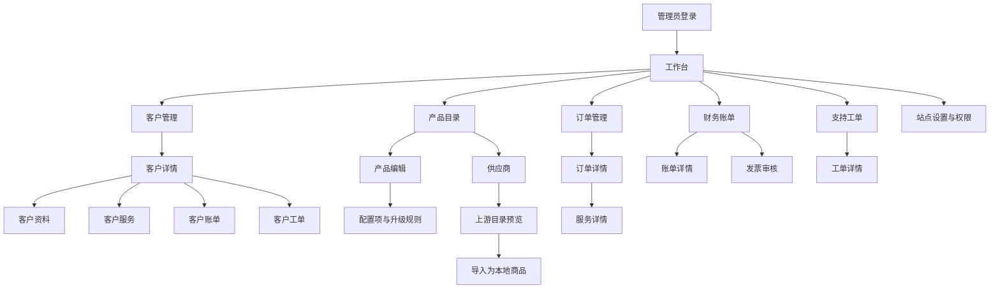

# 管理后台前端设计总契约

状态：当前设计契约。本文和领域页面规格描述实施与复用要求；首批已实现范围见“当前实施状态”，不能以设计覆盖面推断页面接线或浏览器验收完成。

本文定义 Go API + Next.js/React + shadcn/ui 管理后台的视觉风格、公共布局、组件、交互和实施规则。每个页面必须同时具备**页面范围、区域排版、UI组件、交互逻辑、API与权限、状态与验收**，不能只给页面名称、截图或接口列表。完整路由范围从[前端页面设计目录](admin/frontend-pages.md)进入，再阅读对应领域规格。

当前批准的39组必要后台API作为业务边界。信用额度及合同已退役；数据导出、客户自助退款申请和运行时插件安装不恢复，7组暂缓需求不放入设计。旧系统用于参考任务顺序和信息密度；当前API、迁移与测试决定可执行行为。Arco Pro仅作颜色、灰阶和组件质感参考，保持现有组件栈。

| 文档 | 职责 |
| --- | --- |
| [前端页面设计目录](admin/frontend-pages.md) | 必需页面、现有/拟新增/退役路由、领域规格和实施批次 |
| [后台API](admin/api.md)、[需求取舍](admin/api-requirements.md) | 业务范围、字段、权限、版本、幂等和已知验证边界 |
| [客户与服务页面](admin/frontend-customer-service.md) | 客户详情、订单、服务管理六批动作及关联页面 |
| [商品与资源页面](admin/frontend-catalog-resources.md) | 商品、供应商导入、资源、人工库存和编译模块 |
| [运营页面](admin/frontend-operations.md) | 财务、工单、通知、推广与报表 |
| [工作台与系统页面](admin/frontend-system.md) | 登录、工作台、内容、设置、安全、日志与运行状态 |
| [RBAC](admin-rbac.md)、[供应商协议](supplier-protocol.md) | 当前授权边界及外部操作协议 |

## 1. 设计目标与边界

后台是高频运营工具，优先保证扫描、比较、批量处理、状态核对和错误恢复。视觉使用克制的浅色工作台风格，减少装饰性卡片和大面积插图；页面空间优先给筛选、表格、详情和操作结果。

业务能力由 Go API、数据库状态和权限返回决定。前端只负责呈现允许的入口、收集输入、提交明确请求和重读结果，不根据旧页面名称自行创造接口、状态、统计数字或按钮。

本文覆盖当前后台和已确定的后续页面关系，不代表所有旧 PHP 路由已经在 Go 中实现。旧文档记录的 229 条编译路由包含外壳、重定向、错误页和兼容页，不等于 229 个独立业务页面。

## 2. 视觉风格

### 2.1 基调

- 背景使用浅灰白，内容区使用白色数据表面，边框和分隔线区分层级。
- 管理端主色采用 Arco Pro 风格的企业蓝，表示主要动作、当前导航和链接；危险操作使用红色，处理中使用橙色，成功使用绿色。
- 页面分区使用留白和分隔线，不在卡片内继续套卡片。
- 普通控件圆角 4px，重复数据项或弹窗最多 8px；不使用大圆角营销卡片和渐变背景。
- 正文 14px/22px，页标题 22px/30px，分区标题 16px/24px；字距保持 0。
- 金额、编号、IP、版本号使用等宽数字或稳定的 tabular-nums，金额永远显示服务端计算结果。
- 状态徽标必须包含文字和可访问名称，不能只用颜色表达状态。

### 2.2 Arco Pro 设计语言的借鉴范围

Arco Pro 只作为设计语言和信息架构参考，不引入 `@arco-design/*` 运行时依赖，也不复制其组件实现。交互组件继续使用现有 shadcn/ui、Radix 和 lucide-react，业务接口、权限和状态保持 Go API 契约。

借鉴以下特征：

- 明确的中后台层级：顶栏、侧栏、页面标题、工具栏、数据区和结果反馈分层，而不是依靠大量阴影区分。
- 中性灰阶打底，主行动使用蓝色，成功/警告/错误使用稳定语义色；同一页面最多一个主色动作层级。
- 紧凑但可读的表格和表单，字段间距固定，操作按钮按主次分级，图标只作为文字动作的补充。
- 侧栏按业务域分组，当前项使用浅色底和主色文字；父级展开状态与子路由保持同步。
- 卡片、抽屉、弹窗只用于确实需要边界的内容，页面主区优先使用网格、分隔线和留白。
- 筛选、分页、标签、通知和状态徽标使用稳定的视觉位置，避免页面因加载或错误改变结构。

不直接复制以下特征：

- Arco Pro 的品牌 Logo、插画、字体、主题包和组件 DOM。
- 与本项目 API 不对应的统计卡片、快捷入口、插件菜单或演示数据。
- 旧后台的固定宽度、手机溢出、无确认危险按钮和仅依赖颜色的状态提示。

### 2.3 管理端颜色令牌

以下是管理端第一版令牌，命名映射到现有 shadcn/ui 变量。实际 CSS 以 `.admin-theme` 覆盖；管理路由挂载时通过 `body:has(.admin-theme)` 为 Radix Portal 提供相同令牌，离开管理路由后自动恢复客户中心品牌色。

| 语义 | 令牌 | 建议值 | 用途 |
| --- | --- | --- | --- |
| 主色 | `--admin-primary` | `#165DFF` | 主按钮、链接、当前导航、焦点 |
| 主色浅底 | `--admin-primary-soft` | `#E8F3FF` | 当前导航、选中行、提示背景 |
| 页面背景 | `--admin-bg` | `#F7F8FA` | 工作区背景 |
| 表面 | `--admin-surface` | `#FFFFFF` | 表格、表单、详情数据区 |
| 主文字 | `--admin-text` | `#1D2129` | 标题和正文 |
| 次文字 | `--admin-text-secondary` | `#4E5969` | 说明、辅助信息 |
| 弱文字 | `--admin-text-tertiary` | `#86909C` | 时间、编号、占位提示 |
| 边框 | `--admin-border` | `#E5E6EB` | 输入框、分隔线、表格边界 |
| 成功 | `--admin-success` | `#00B42A` | 已启用、已支付、完成 |
| 警告 | `--admin-warning` | `#FF7D00` | 待处理、执行中、即将到期 |
| 错误 | `--admin-danger` | `#F53F3F` | 失败、拒绝、危险操作 |
| 信息 | `--admin-info` | `#165DFF` | 帮助、处理中说明、链接 |

颜色使用规则：主色只表达可操作和选中状态；成功、警告、错误不能只显示颜色，必须同时显示文字或图标；危险按钮不使用主色伪装；图表颜色从这些语义色派生，不为每个页面单独发明颜色。阴影只用于抽屉、弹窗和悬浮层，普通数据区使用边框。

危险操作的按钮和文字使用更深的 `--destructive: #CB2632` 提高对比度；`--admin-danger: #F53F3F` 保留作为图形语义色，不直接用于小字号错误文字。

### 2.4 尺寸基线

| 区域 | 桌面 | 平板 | 手机 |
| --- | --- | --- | --- |
| 顶栏 | 60px | 60px | 56px |
| 导航 | 200px 当前业务侧栏 | 64px 图标栏 | 抽屉，宽 280px 以内 |
| 内容边距 | 20px | 20px | 16px |
| 主区栏距 | 24px | 20px | 16px |
| 普通控件 | 36px | 36px | 44px |
| 表头/数据行 | 40px / 至少 44px | 同左，表格容器滚动 | 卡片或容器内滚动 |
| 详情摘要栏 | 320px | 下移或折叠 | 折叠在对象身份之后 |
| 表单弹窗 | 最大 640px | 最大 640px | `calc(100% - 32px)` |

断点统一为：`<768px` 手机，`768–1199px` 平板，`>=1200px` 桌面。整页禁止横向滚动；只有表格、代码、日志等确需比较的容器允许内部横向滚动。

## 3. 公共后台外壳

### 3.1 桌面结构

```text
┌──────────────────────────────────────────────────────────────────┐
│ Logo   工作台 客户 业务 财务 工单 功能 设置     管理员 退出 │ 60px
├───────────────┬──────────────────────────────────────────────────┤
│ 当前业务导航   │ 面包屑 / 页面头部：返回 / 标题 / 页面主操作       │
│ 200px          │ 工具栏：筛选、批量、视图、刷新                     │
│               │ 主内容：表格 / 摘要 + 标签 / 分组表单              │
│               │ 底部：总数、分页、任务进度、保存结果                 │
└───────────────┴──────────────────────────────────────────────────┘
```

顶栏业务域切换后，侧栏只显示该域下可访问的分组。工作台隐藏桌面侧栏。手机通过抽屉展示完整授权导航，顶栏业务域不挤占窄屏空间。顶栏右侧保留管理员姓名、退出和“查看官网”；该链接不建立客户会话。管理员代客户登录仅从客户详情的受控独立动作进入。系统状态、队列和通知只有API提供真实数据时才显示。

### 3.2 导航分组

导航菜单按权限过滤，但权限过滤只负责呈现入口，API 仍是最终授权边界。推荐分组如下：

| 分组 | 页面 |
| --- | --- |
| 工作台 | 工作台、待处理事项、统计入口 |
| 客户 | 客户管理、客户分组、客户文件 |
| 商品与服务 | 产品目录、服务分组、服务主机、供应商、下载中心 |
| 订单 | 订单管理、取消申请、代客户下单 |
| 财务 | 财务账单、发票审核、交易、优惠码 |
| 工单与通知 | 支持工单、工单部门、预设回复、通知管理 |
| 内容 | 新闻与知识库、下载分类 |
| 系统 | 管理员与权限、站点设置、操作审计、迁移复核 |
| 报表 | 统计报表 |

分组支持展开/收起，当前页面的父分组保持展开，子路由保持高亮。待处理数量、未读数量和错误数量使用独立徽标，不能把数量写入菜单名称，也不能用前端猜测数量。

### 3.3 移动端外壳

手机顶栏只保留 Logo、返回或菜单、通知和用户菜单。侧栏变为抽屉，打开时锁定背景滚动并支持 Esc/点击遮罩关闭。页面顺序为对象身份、主要状态、核心内容、操作和日志；筛选进入抽屉或 Sheet，危险操作保持可见文字按钮，不能藏在长按手势中。

## 4. 页面模板

### 4.1 列表页

```text
返回（需要时） → 页面标题/说明 → 新建/同步等当前页面操作
常用筛选：关键词、状态、时间、客户或产品
高级筛选：可折叠，手机进入筛选面板
选中数量 → 经过权限和状态确认的批量操作
表格：关键身份、状态、金额、时间、操作
总数/当前筛选摘要 → 分页
```

筛选值、排序、页码和每页数量必须可从 URL 或可恢复页面状态重建。筛选后回到第一页。加载时保留筛选值和表头，空态说明是“没有数据”还是“当前筛选无结果”，错误态提供重试。

桌面表格允许自然换行，身份和状态列优先保留；金额、状态和主操作不能压缩成无法理解的图标。手机默认降级为“主字段 + 状态 + 操作”的卡片，确需比较的表格使用内部滚动容器。

### 4.2 详情页

```text
返回列表 → 对象名称/编号 → 状态 → 受权主操作
对象摘要（客户、账单、服务或订单）
标签页或分区内容                     右侧 320px 摘要/关联信息
时间线、审计和操作结果
```

客户详情使用固定标签顺序：摘要、资料、服务、账单、交易、工单、日志、通知、文件、推广。直接打开任一子页面仍保留客户身份和返回客户入口。手机将标签变为横向滚动或选择器，切换客户前清理旧的异步数据。

### 4.3 编辑页

编辑页使用“返回 + 标题/编号 + 保存”头部，表单按业务分组，桌面两列、手机单列。保存按钮只在有变更且权限允许时可用；提交中保持稳定宽度并锁定相关字段。失败时保留安全草稿，部分保存或超时显示“待核对”并重新读取服务器基线，不自动重复提交。

### 4.4 抽屉和弹窗

快速编辑、客户归属、筛选和轻量详情使用抽屉；跨步骤或高风险操作使用弹窗。关闭未保存内容前提示用户。弹窗必须锁定焦点、支持 Esc、正文独立滚动，手机最大高度为 `calc(100dvh - 32px)`。

## 5. 交互状态契约

所有页面和公共组件必须定义以下状态：加载、空数据、筛选无结果、接口错误、无权限、提交中、成功、失败、冲突、处理中、未知状态。各数据分区独立加载、错误和重试；隐藏页签不预取受限数据，切换客户/对象/期间后旧响应不能覆盖新页面。

- 加载：保留导航、页面标题、筛选和表头，使用骨架或局部加载，避免整页闪烁。
- 空态：说明对象范围；列表提供清空筛选或创建入口，详情显示对象不存在或不可访问。
- 无权限：说明需要的管理能力，不能伪装成空列表；页面按钮隐藏或禁用不替代 API 拒绝。
- 写入成功：重读所有受影响的对象、卡片、表格和时间线，并保留结果提示。
- 写入失败：展示业务可理解原因，保留输入；开发细节只进入受控日志。
- 409 冲突：提示数据已变化，提供重新加载，不能覆盖服务器新版本。
- 未知写结果：显示“结果待核对”，保留原请求体及稳定幂等键；只使用该动作已有的结果查询/原键恢复协议。没有安全恢复保证的动作停止自动重发。编辑草稿与尚待确认的原请求分开，不能改完输入再冒充原请求重试。
- 异步任务：显示排队、执行中、成功、失败或待人工核验；没有任务 ID 时通过服务状态和活动记录核对。
- 未知枚举：保留原始值并显示“未知状态”，不能默认为成功、活跃或 0。

退款、余额调整、发票审核、取消订单、终止服务、重装、关机、删除、批量发送和重置密钥等操作必须二次确认。确认内容包括对象、影响范围、不可逆性、操作者和必要的备注。

敏感字段默认脱敏。密码、API 密钥、上游 Token、支付凭据和客户证件信息的查看、复制和下载必须分别受权限控制；上游凭据不得出现在错误、日志或前端 URL 中。

## 6. 页面关系



页面跳转必须保留来源上下文：列表筛选、排序、页码和选中状态在返回时恢复；详情读取失败不能显示上一次对象的残留内容；写入成功后返回详情或列表的规则由页面契约明确，不由组件自行决定。

## 7. 当前路由到设计模板的映射

| 路由 | 模板 | 关系与主要交互 |
| --- | --- | --- |
| `/admin` | 工作台 | 指标、待办、报表入口；每个指标独立加载和重试 |
| `/admin/customers` | 客户列表 | 搜索、状态/分组筛选、分页、客户详情入口 |
| `/admin/customers/{id}` | 客户详情 | 客户摘要和标签页容器，保持客户上下文 |
| `/admin/products` | 商品列表 | 分组树、商品行、上架状态和编辑入口 |
| `/admin/products/{id}` | 商品编辑 | 基本、价格、配置、模块、升级和推广分区 |
| `/admin/suppliers` | 供应商工作台 | 账户、批量目录预览、多账期与客户选配导入、同步和错误状态 |
| `/admin/orders` | 订单列表 | 筛选、审核、取消和详情入口；批量操作逐项核对 |
| `/admin/orders/{id}` | 订单详情 | 订单项目、账单、服务和管理员备注 |
| `/admin/services` | 服务列表 | 客户、状态、到期时间和异步交付状态 |
| `/admin/services/{id}` | 服务详情 | 生命周期、交付记录、敏感凭据和操作日志 |
| `/admin/invoices` | 账单列表 | 状态筛选、支付、作废、退款入口和审计 |
| `/admin/invoices/{id}` | 账单详情 | 项目、交易、余额和受权财务操作 |
| `/admin/invoice-applications` | 发票审核列表 | 待审核、驳回、开具和电子文件状态 |
| `/admin/tickets` | 工单列表 | 部门范围、未读、状态、处理人和分页 |
| `/admin/tickets/{id}` | 工单详情 | 时间线、回复、内部备注、附件和状态操作 |
| `/admin/content` | 内容工作台 | 新闻/知识库、草稿、发布和 SEO 字段 |
| `/admin/downloads` | 下载中心 | 分类、权限、产品关联和文件版本 |
| `/admin/reports` | 报表 | 当前标签独立加载/重试；销售账单展开/预计与历史确认、工单处理人/客户消息评分、年度现金/费用、分类产品数量；权限空值与查询范围见恢复契约 |
| `/admin/access` | 权限管理 | 角色、管理员、能力、客户/工单范围和版本冲突 |
| `/admin/settings` | 站点设置 | 基本信息、品牌、SEO、维护和验证码开关 |
| `/admin/audit` | 审计列表 | 时间、操作者、对象、结果和脱敏详情 |
| `/admin/migrations` | 迁移复核 | 待复核记录、差异、接受/拒绝和操作审计 |

供应商页面必须保持 provider-neutral：UI 使用供应商类型元数据、账户、目录、导入、同步和错误这些稳定概念；魔方财务的特有字段只出现在对应 Adapter 的扩展区，不能让页面结构绑定单一供应商。

本节仅列常见模板，不是全量页面清单。所有当前页面、登录入口及退役路由的设计归属以[页面目录](admin/frontend-pages.md)为准；同一路由的页签、弹窗和步骤同样必须在领域规格中展开。

### 7.1 报表独立加载与查询

收入、客户排名、产品、每日运营、销售和工单六类报表只请求当前标签。加载、空态、错误与重试属于当前报表，不等待其余五类接口成功；切换标签、查询期间或权限后，旧请求不能覆盖新数据，统计卡也只显示当前结果。

年度现金与兼容业务消费按年查询；销售默认上海月，可选快捷期间或自定日期；产品、每日运营和工单默认上海年月，处理人报表可自定日期。客户排名明确显示“全历史余额流水·前十名”，隐藏不适用的年月输入，不让用户误认为切换年份改变排名。有效查询条件写入 URL，兼容既有标签别名，刷新与前进后退能恢复；重复查询同一条件仍重新请求。

每日运营的 `ticket_metrics_available=false` 或工单字段为 `null` 时显示“无权限”，其余商业指标继续展示；有权但无事件才显示零。独立工单标签无 `tickets.view` 时显示明确拒绝状态，不发出伪成功空表请求；服务端仍执行 `reports.view`、工单权限和当前部门范围，客户端标签不替代授权。工作台的工单指标也不得将无权限显示为零。

报表与监控不提供数据导出，页面不显示 CSV 按钮或导出状态。报表接口仅返回 JSON；显式 `format=csv` 及其他非 JSON 格式返回 `400 invalid_report_format`，详见[查询契约](credit-cash-reporting.md#查询接口与产品边界)。电子发票、工单附件、客户文件与下载中心等活动业务文件继续按原授权提供下载；合同下载已退役。

销售默认全部授权客户范围内的销售，选项独立加载/重试，不能获取完整员工目录；明细按账单分页再展开，当前页明细与完整筛选汇总有明确区别。预计只加总已配置行，未配置显示文字和计数；历史确认/冲正/原金额不随当前规则变化。工单处理人筛选、排序和分页写URL，评分取公开消息原作者和创建期间，客户侧每合格消息一次。年度人工费用显示可追溯台账，未知写结果保留原请求与幂等键以重试确认；无全局费用范围时费用、总支出和净额显示无权限。分类产品页按分类分页，汇总覆盖全部匹配组，件数和单数分别标注。

既有报表实现与隔离数据库/模拟API浏览器的验收边界见[恢复契约](report-restoration-contract.md)。这些证据不覆盖本轮页面重排设计或真实Go API浏览器全链路；旧数据迁移/对账及外部凭证另验，不在设计总契约累计过程记录。

## 8. 权限、数据和安全要求

- 侧栏、页面、按钮和字段均按 `/api/v1/me` 及具体接口能力呈现。
- 客户范围、工单部门范围和超级管理员保护是独立边界，不能由菜单可见性替代。
- 只读管理员可以看到对象和值，但不显示可写表单作为“灰色假功能”。
- 写操作使用明确HTTP方法，按各动作契约发送其实际支持的幂等键/版本；成功后重读，不对全部writer假设同一恢复保证。
- 金额、折扣、税费、余额和可退款金额只显示服务端结果，前端不自行计算最终金额。
- 上游目录、邮件正文、工单内容和 HTML 内容默认转义或隔离渲染。
- 前端错误文案不能泄露凭据、Token、SQL、堆栈或上游完整响应。

## 9. 实施批次与验收

### 批次 A：公共壳和样板

完成 `AdminShell`、分组导航、顶栏、页面头部、筛选栏、标准表格、详情标签、状态徽标、确认弹窗和错误/空态组件。以登录、客户列表、客户详情和客户资料作为第一个完整样板。

验收视口：桌面 1440px、平板 1024px/768px、手机 390px/320px。检查无横向溢出、键盘可用、抽屉焦点、长文本换行、加载/错误/无权限状态和返回列表上下文。

### 批次 B：商品、服务、订单和供应商

统一产品编辑、配置项、订单详情、服务详情和供应商工作台。重点验证上游导入为本地商品、同步状态、交付任务、待人工核验和失败重试，不把上游价格直接当本地售价。

### 批次 C：财务、发票和工单

统一账单详情、发票审核、交易、退款、工单时间线、附件和部门范围。重点验证危险操作确认、幂等、版本冲突、成功后重读以及只读角色拒绝写入。

### 批次 D：内容、通知、报表、权限和设置

完成内容发布、下载、通知、报表、管理员权限、站点设置和审计。每个页面必须补齐真实 API 字段、权限能力、空态、错误态和浏览器验收证据。

每个批次都需要通过：

1. Next.js typecheck、lint、生产构建。
2. Go API 权限和状态回归测试。
3. 桌面、平板、390px 手机真实浏览器流程。
4. 超级管理员、只读管理员和无权限用户边界。
5. 写操作成功、失败、超时、409 冲突和重复提交场景。

未完成真实接口或权限核对的页面保持 `DRAFT`，不能因为导航入口存在就标记为完成。

### 当前实施状态

后台外壳现采用[Next Shadcn Dashboard Starter固定Radix版](admin/frontend-development.md#成品模板与业务接线)的Sidebar/Header结构，原顶部业务域导航已替换为侧边栏折叠菜单，账户菜单位于底部。客户、服务、新购订单及账单的列表/详情使用模板容器及卡片，服务、订单和账单手机列表使用卡片展示；交易流水使用同一公共列表、现金汇总卡片和手机流水卡片；其余业务页共用新外壳，内部复杂交互逐页接线，不能视作全部页面已重写。后台采用模板中性亮色主题，公开站点保持独立。

首批已重构 `AdminShell`、工作台及客户列表、新建、详情。工作台使用4项真实指标、5项待办和商品/人员双排名，排名区域独立加载与重试；列表提供高级筛选、URL分页和返回上下文；新建提交前确认，初始密码仅存内存；详情接真实summary及10个按需页签，资料/联系人支持版本冲突和原请求恢复。管理员登录与独立Cookie、现有权限和写入协议继续复用。

Web lint/typecheck及隔离webpack生产构建已通过；独立PG18真实Go API浏览器已验证1440/768/390px无横向溢出、手机菜单、顶栏吸顶、排名单区500与独立重试、返回列表筛选，以及客户创建、资料保存和联系人创建的持久化。后端相关专项30项取得RUN/PASS、零跳过；具体边界见[领域验收矩阵](architecture/contract-verification-matrix.md)。这些证据不覆盖全部后台、未测视口/权限/失败组合、真实外部渠道、部署或生产。

客户详情已接代建未付充值单和推荐人调整；订单、人工账单、工单新建按各自权限精确读取并锁定客户，返回保留原页签和筛选。写前及确认回执前复核实际管理员；未知结果保留原body/key，含购买凭据或工单正文的请求仅持久保存安全核验标记，刷新后先核对结果再解锁。人工库存列表、新建/编辑/详情/显式释放及人工交付库存选择已接线；库存成本和上游期限独立保存，凭据只写。服务管理已按需接入长期固定续费价/合同恢复、客户期限纠错/补偿及自动续费独立区域，版本/预览、身份和归属核验及未知恢复分别处理；代续费、批量、单次固定应付、状态纠错、人工收款及服务转移仍待接线。API、UI和验证状态分别维护于[需求台账](admin/api-requirements.md)，声明中的部分完成状态不因首批样板通过而整体提升；本设计文档不累计过程日志。

## 10. 每个页面的设计交付单

页面标识使用路由模式；同页子视图追加语义页签，如 `/admin/reports#sales`，不为了每个弹窗新增路由。当前 `[id]` 表示Next页面动态段，API文档的 `{id}` 表示HTTP路径参数。

| 项目 | 必须明确的内容 |
| --- | --- |
| 页面与边界 | 中文名称、现有/拟新增/兼容/退役、用户任务、入口、返回路径、所属领域；列表/新建/详情/编辑分开列出 |
| 排版 | 从上到下的区域顺序、桌面栏宽/比例、核心列和排序、筛选位置、页签、主次操作、底部反馈 |
| 组件 | 所用基础/业务组件、字段类型、必填/只读/脱敏、表格列、详情字段、校验和禁用条件；新组件标为拟实现 |
| 交互 | 打开前读取、用户输入、校验、预览/确认/提交顺序、关闭和取消、返回、成功刷新范围、选中清单如何失效 |
| API与权限 | 每个动作method/path、参数来源、权限/客户或部门范围、资源自身version、稳定key要求及领域协议链接 |
| 状态 | 局部加载、两种空态、401/403/404、409、业务拒绝、异步pending/unknown、重试/查询恢复；金额null不显示0 |
| 响应式与无障碍 | 桌面/平板/手机排列、容器滚动、44px点击区、键盘顺序、焦点回归、label/错误关联和状态播报 |
| 交付与验收 | 设计稿对应的路由/页签/状态、实际接口接线、各视口浏览器结果；设计、实现、E1/E2/E3证据独立标记 |

每个页面至少给默认态及适用的空态、加载、接口错误、无权限画面；有写入则补提交中、成功、校验失败、409和结果待核对。有预览或异步步骤的动作须另给确认页与进度/核验结果。HTML、Figma或截图应注明页面标识和状态；样稿审核通过后才接React与真实API。

## 11. 组件与业务动作规范

实施复用规则及组合示例见[后台前端开发与复用](admin/frontend-development.md)。常规列表复用 `AdminListPage`、`AdminListRegion`、`ResourceTable` 与受控分页，领域模块保留 URL 校验、权限、报价、版本和未知结果恢复；不以通用 CRUD 代替业务动作。

现有基础组件位于 `web/src/components/ui/`：Button、Input、Textarea、Label、Select、Checkbox、Badge、Alert、Skeleton、Table、Dialog及模板Sidebar、Sheet、Card、Breadcrumb、DropdownMenu；Tooltip等使用现有Radix能力，图标使用lucide-react。不为本设计额外引入组件框架。

下表定义复用目标，不表示这些业务组件已全部存在；实现前先检查当前组件，名称可沿现有约定。

| 组件职责 | 必需内容及行为 |
| --- | --- |
| 页面头部 | 面包屑、返回、标题/对象编号、主状态和一个主动作；次要操作放文字菜单，危险操作有独立确认 |
| 筛选与分页 | 常用字段横排、高级字段折叠、当前条件摘要、查询/清空、结果数；只提交API支持的参数，不把当前页筛选当全量筛选 |
| 数据表/窄屏记录 | 关键身份链接、状态文字、服务端金额、时间、操作；选择有明确范围，跨页批量须后端支持，不伪造“全选全部” |
| 对象与分区状态 | 固定身份、受权限约束的摘要、局部Skeleton/Empty/Retry/Forbidden；切换对象清旧内容，有权无数据才显示真实0 |
| 金额/期限/敏感值 | 整数分格式化、业务口径和币种标注；区分客户期限与上游观测；敏感值只在授权操作后短暂展示，不放URL/草稿存储 |
| 版本表单 | 字段label/帮助/错误、脏状态、保存/取消、服务器baseline；不同资源的version不混用，409保留安全草稿并要求重读 |
| 预览确认步骤 | 对象及范围、旧值→新值、金额/期限、原因、报价时效；提交使用原预览及对应version，变化后重新预览 |
| 写入结果与恢复 | 稳定key/原body、已确认/失败/待核对、操作编号、明确恢复入口；同次重试不换key，不对全部writer承诺幂等 |
| 异步进度与批量结果 | 单项对象、账单/任务、执行阶段和错误；本地支付成功与上游续费成功分列，部分成功不显示整体失败后全量重做 |
| 业务文件 | 独立上传/业务保存状态，授权下载、大小/类型限制、上传待核对；不生成原始对象存储公开地址，不恢复通用数据导出 |

普通筛选可进入URL；幂等键、完整请求体、密码、支付凭据和一次性链接不进入URL。需要跨刷新恢复的安全意图绑定当前管理员、门户和对象；秘密仅在内存暂存，退出时清理本管理员草稿，不能清除另一个门户的会话或意图。

按钮行为按动作定义：GET或预览不执行业务写入，确认才提交；“取消”仅关闭尚未提交的交互，不能宣称撤销在途请求。权限或对象归属变化后清除旧选择并重新读取；异步响应必须核对当前对象、查询和归属代次，不能恢复已转出客户的数据。

## 12. 现有图片素材与图标

设计和实现优先复用 `web/public/assets/` 的系统图标与国家/地区旗帜。浏览器路径省略 `web/public`，例如 `/assets/system/windows.svg`、`/assets/country/CN.png`。素材目录不是业务数据或权限事实，图片不能代替文字、状态或服务端地域信息。

| 素材 | 现有文件与用法 | 展示规则 |
| --- | --- | --- |
| 操作系统图标 | `system/centos.svg`、`debin.svg`、`esxi.svg`、`fedora.svg`、`ubuntu.svg`、`windows.svg`、`other.svg` | 商品配置/系统选择、服务详情已装系统、资源列表；文字名称和版本仍由真实数据提供。Debian映射实际文件名 `debin.svg`，不能按惯常拼法请求不存在的debian.svg |
| 国家/地区旗帜 | `country/` 的PNG，含大写代码如 `CN.png`、`US.png`、部分 `-y.png` 变体和少量名称文件 | 商品地域、机房/节点和明确返回地域的资源记录；代码对应表只选真实存在文件，不根据IP/域名猜地域。并非所有素材都是国家，也不能假设代码和圆形变体全覆盖 |
| 旗帜形态 | 已核对 `CN.png/US.png` 为长方形，`CN-y.png/US-y.png` 为透明背景圆形；其他项按文件实际形态选取 | 表格统一用长方形24×16容器，卡片可选圆形24×24，均object-contain；不强行裁切国旗，不将缺少-y变体视为整个地域不存在 |
| 提现渠道图标 | `withdraw/alipay.svg` 及已有银行SVG | 仅在真实支持的提现方式旁展示；图标存在不表示已开通该方式或实现自动打款 |
| 品牌/空态 | 顶层现有Logo、登录背景、`empty.svg`及通知图标 | 复用对应品牌/空态/通知场景；空态仍给原因、范围和下一步，不能只放图片 |

系统映射按稳定键/别名白名单实现，例如debian→debin、windows→windows；版本号单独显示。未识别系统回退 `other.svg` 并保留原始安全名称，不能把发行版图标推断为可安装系统。国家/地区映射只使用受控文件清单，不直接把任意用户输入拼入路径；缺文件/加载失败回退中性地域图标和文字，不能默认CN或其他国家。

拟复用组件职责为SystemIcon、RegionFlag、ProviderIcon：尺寸可选16/20/24/32px，占位尺寸固定避免跳动；移动端图标可保持20–24px，点击操作的容器仍至少44px。系统或旗帜旁已有同名文字时图片使用空alt、作为装饰；若图片独立表达身份则提供完整中文可访问名称及可见文字/提示。状态徽标不得由国旗或系统Logo替代；普通操作/导航图标继续用lucide-react。

本轮只登记使用规范和已有素材，不移动、重命名或重新生成这些文件。部分素材目前为未跟踪文件，设计可引用它们的位置；实际接线和发布时须核对引用清单与构建产物是否包含，文档完成不代表图片已被纳入Git或部署。
