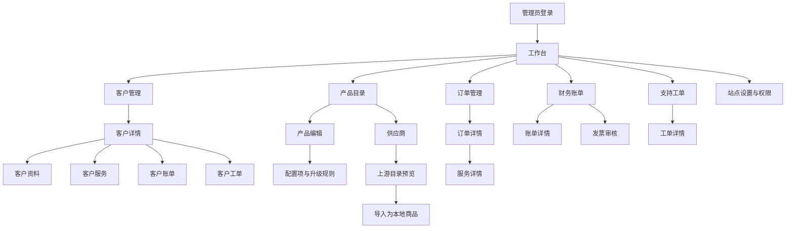

# 管理后台前端设计总契约

状态：设计基线；管理端主题和公共外壳已实施，逐页改造按批次推进

本文定义 Go API + Next.js/React + shadcn/ui 管理后台的视觉风格、公共布局、交互行为、页面关系和实施顺序。旧 PHP 后台仅用于理解业务语义、页面关系和字段分组；旧页面的窄屏溢出、侧栏状态不稳定、权限与菜单混淆等问题不作为新实现标准。

参考资料：

- 旧后台结构与排版证据：`/www/wwwroot/zjmf-manger-decoded-副本/docs/frontend/28-admin-built-layout-reading.md`
- 旧后台浏览器观察：`/www/wwwroot/zjmf-manger-decoded-副本/docs/frontend/29-admin-browser-observations.md`
- 逐页排版契约：`/www/wwwroot/zjmf-manger-decoded-副本/docs/frontend/12-admin-page-layout-details.md`
- 组件和响应式契约：`/www/wwwroot/zjmf-manger-decoded-副本/docs/frontend/19-component-interaction-contract.md`
- 后台首批样板：`/www/wwwroot/zjmf-manger-decoded-副本/docs/frontend/24-first-batch-page-specs.md`
- 当前权限边界：`docs/admin-rbac.md`
- 当前供应商协议：`docs/supplier-protocol.md`

## 1. 设计目标与边界

后台是高频运营工具，优先保证扫描、比较、批量处理、状态核对和错误恢复。视觉使用克制的浅色工作台风格，减少装饰性卡片和大面积插图；页面空间优先给筛选、表格、详情和操作结果。

业务能力由 Go API、数据库状态和权限返回决定。前端只负责呈现允许的入口、收集输入、提交明确请求和重读结果，不根据旧页面名称自行创造接口、状态、统计数字或按钮。

本文覆盖当前后台和已确定的后续页面关系，不代表所有旧 PHP 路由已经在 Go 中实现。旧文档记录的 229 条编译路由包含外壳、重定向、错误页和兼容页，不等于 229 个独立业务页面。

## 2. 视觉风格

### 2.1 基调

- 背景使用浅灰白，内容区使用白色数据表面，边框和分隔线区分层级。
- 管理端主色采用 Arco Pro 风格的企业蓝，表示主要动作、当前导航和链接；危险操作使用红色，处理中使用橙色，成功使用绿色。
- 页面分区使用留白和分隔线，不在卡片内继续套卡片。
- 普通控件圆角 4px，重复数据项或弹窗最多 8px；不使用大圆角营销卡片和渐变背景。
- 正文 14px/22px，页标题 22px/30px，分区标题 16px/24px；字距保持 0。
- 金额、编号、IP、版本号使用等宽数字或稳定的 tabular-nums，金额永远显示服务端计算结果。
- 状态徽标必须包含文字和可访问名称，不能只用颜色表达状态。

### 2.2 Arco Pro 设计语言的借鉴范围

Arco Pro 只作为设计语言和信息架构参考，不引入 `@arco-design/*` 运行时依赖，也不复制其组件实现。交互组件继续使用现有 shadcn/ui、Radix 和 lucide-react，业务接口、权限和状态保持 Go API 契约。

借鉴以下特征：

- 明确的中后台层级：顶栏、侧栏、页面标题、工具栏、数据区和结果反馈分层，而不是依靠大量阴影区分。
- 中性灰阶打底，主行动使用蓝色，成功/警告/错误使用稳定语义色；同一页面最多一个主色动作层级。
- 紧凑但可读的表格和表单，字段间距固定，操作按钮按主次分级，图标只作为文字动作的补充。
- 侧栏按业务域分组，当前项使用浅色底和主色文字；父级展开状态与子路由保持同步。
- 卡片、抽屉、弹窗只用于确实需要边界的内容，页面主区优先使用网格、分隔线和留白。
- 筛选、分页、标签、通知和状态徽标使用稳定的视觉位置，避免页面因加载或错误改变结构。

不直接复制以下特征：

- Arco Pro 的品牌 Logo、插画、字体、主题包和组件 DOM。
- 与本项目 API 不对应的统计卡片、快捷入口、插件菜单或演示数据。
- 旧后台的固定宽度、手机溢出、无确认危险按钮和仅依赖颜色的状态提示。

### 2.3 管理端颜色令牌

以下是管理端第一版令牌，命名映射到现有 shadcn/ui 变量。实际 CSS 以 `.admin-theme` 覆盖；管理路由挂载时通过 `body:has(.admin-theme)` 为 Radix Portal 提供相同令牌，离开管理路由后自动恢复客户中心品牌色。

| 语义 | 令牌 | 建议值 | 用途 |
| --- | --- | --- | --- |
| 主色 | `--admin-primary` | `#165DFF` | 主按钮、链接、当前导航、焦点 |
| 主色浅底 | `--admin-primary-soft` | `#E8F3FF` | 当前导航、选中行、提示背景 |
| 页面背景 | `--admin-bg` | `#F7F8FA` | 工作区背景 |
| 表面 | `--admin-surface` | `#FFFFFF` | 表格、表单、详情数据区 |
| 主文字 | `--admin-text` | `#1D2129` | 标题和正文 |
| 次文字 | `--admin-text-secondary` | `#4E5969` | 说明、辅助信息 |
| 弱文字 | `--admin-text-tertiary` | `#86909C` | 时间、编号、占位提示 |
| 边框 | `--admin-border` | `#E5E6EB` | 输入框、分隔线、表格边界 |
| 成功 | `--admin-success` | `#00B42A` | 已启用、已支付、完成 |
| 警告 | `--admin-warning` | `#FF7D00` | 待处理、执行中、即将到期 |
| 错误 | `--admin-danger` | `#F53F3F` | 失败、拒绝、危险操作 |
| 信息 | `--admin-info` | `#165DFF` | 帮助、处理中说明、链接 |

颜色使用规则：主色只表达可操作和选中状态；成功、警告、错误不能只显示颜色，必须同时显示文字或图标；危险按钮不使用主色伪装；图表颜色从这些语义色派生，不为每个页面单独发明颜色。阴影只用于抽屉、弹窗和悬浮层，普通数据区使用边框。

危险操作的按钮和文字使用更深的 `--destructive: #CB2632` 提高对比度；`--admin-danger: #F53F3F` 保留作为图形语义色，不直接用于小字号错误文字。

### 2.4 尺寸基线

| 区域 | 桌面 | 平板 | 手机 |
| --- | --- | --- | --- |
| 顶栏 | 56px | 56px | 56px |
| 导航 | 224px 展开 | 64px 图标栏 | 抽屉，宽 280px 以内 |
| 内容边距 | 24px | 20px | 16px |
| 主区栏距 | 24px | 20px | 16px |
| 普通控件 | 36px | 36px | 44px |
| 表头/数据行 | 40px / 至少 44px | 同左，表格容器滚动 | 卡片或容器内滚动 |
| 详情摘要栏 | 320px | 下移或折叠 | 折叠在对象身份之后 |
| 表单弹窗 | 最大 640px | 最大 640px | `calc(100% - 32px)` |

断点统一为：`<768px` 手机，`768–1199px` 平板，`>=1200px` 桌面。整页禁止横向滚动；只有表格、代码、日志等确需比较的容器允许内部横向滚动。

## 3. 公共后台外壳

### 3.1 桌面结构

```text
┌──────────────────────────────────────────────────────────────────┐
│ Logo / 折叠       面包屑或全局搜索       状态  通知  管理员 退出 │ 56px
├───────────────┬──────────────────────────────────────────────────┤
│ 分组导航       │ 页面头部：返回 / 标题 / 说明 / 页面主操作         │
│ 224px          │ 工具栏：筛选、批量、视图、刷新                     │
│               │ 主内容：表格 / 摘要 + 标签 / 分组表单              │
│               │ 底部：总数、分页、任务进度、保存结果                 │
└───────────────┴──────────────────────────────────────────────────┘
```

顶栏右侧保留管理员姓名、退出和“查看客户中心”；系统状态、队列和通知只有 API 提供真实数据时才显示。页面头部必须能够承载返回列表、对象编号、状态和主要动作，不能只显示一个标题。

### 3.2 导航分组

导航菜单按权限过滤，但权限过滤只负责呈现入口，API 仍是最终授权边界。推荐分组如下：

| 分组 | 页面 |
| --- | --- |
| 工作台 | 工作台、待处理事项、统计入口 |
| 客户 | 客户管理、客户分组、客户文件 |
| 商品与服务 | 产品目录、服务分组、服务主机、供应商、下载中心 |
| 订单 | 订单管理、取消申请、代客户下单 |
| 财务 | 财务账单、发票审核、交易、优惠码 |
| 工单与通知 | 支持工单、工单部门、预设回复、通知管理 |
| 内容 | 新闻与知识库、下载分类 |
| 系统 | 管理员与权限、站点设置、操作审计、迁移复核 |
| 报表 | 统计报表 |

分组支持展开/收起，当前页面的父分组保持展开，子路由保持高亮。待处理数量、未读数量和错误数量使用独立徽标，不能把数量写入菜单名称，也不能用前端猜测数量。

### 3.3 移动端外壳

手机顶栏只保留 Logo、返回或菜单、通知和用户菜单。侧栏变为抽屉，打开时锁定背景滚动并支持 Esc/点击遮罩关闭。页面顺序为对象身份、主要状态、核心内容、操作和日志；筛选进入抽屉或 Sheet，危险操作保持可见文字按钮，不能藏在长按手势中。

## 4. 页面模板

### 4.1 列表页

```text
返回（需要时） → 页面标题/说明 → 新建/导出/同步
常用筛选：关键词、状态、时间、客户或产品
高级筛选：可折叠，手机进入筛选面板
选中数量 → 经过权限和状态确认的批量操作
表格：关键身份、状态、金额、时间、操作
总数/当前筛选摘要 → 分页
```

筛选值、排序、页码和每页数量必须可从 URL 或可恢复页面状态重建。筛选后回到第一页。加载时保留筛选值和表头，空态说明是“没有数据”还是“当前筛选无结果”，错误态提供重试。

桌面表格允许自然换行，身份和状态列优先保留；金额、状态和主操作不能压缩成无法理解的图标。手机默认降级为“主字段 + 状态 + 操作”的卡片，确需比较的表格使用内部滚动容器。

### 4.2 详情页

```text
返回列表 → 对象名称/编号 → 状态 → 受权主操作
对象摘要（客户、账单、服务或订单）
标签页或分区内容                     右侧 320px 摘要/关联信息
时间线、审计和操作结果
```

客户详情使用固定标签顺序：摘要、资料、服务、账单、交易、信用额度、工单、日志、通知、文件、推广。直接打开任一子页面仍保留客户身份和返回客户入口。手机将标签变为横向滚动或选择器，切换客户前清理旧的异步数据。

### 4.3 编辑页

编辑页使用“返回 + 标题/编号 + 保存”头部，表单按业务分组，桌面两列、手机单列。保存按钮只在有变更且权限允许时可用；提交中保持稳定宽度并锁定相关字段。失败时保留安全草稿，部分保存或超时显示“待核对”并重新读取服务器基线，不自动重复提交。

### 4.4 抽屉和弹窗

快速编辑、客户归属、筛选和轻量详情使用抽屉；跨步骤或高风险操作使用弹窗。关闭未保存内容前提示用户。弹窗必须锁定焦点、支持 Esc、正文独立滚动，手机最大高度为 `calc(100dvh - 32px)`。

## 5. 交互状态契约

所有页面和公共组件必须定义以下状态：加载、空数据、筛选无结果、接口错误、无权限、提交中、成功、失败、冲突、处理中、未知状态。

- 加载：保留导航、页面标题、筛选和表头，使用骨架或局部加载，避免整页闪烁。
- 空态：说明对象范围；列表提供清空筛选或创建入口，详情显示对象不存在或不可访问。
- 无权限：说明需要的管理能力，不能伪装成空列表；页面按钮隐藏或禁用不替代 API 拒绝。
- 写入成功：重读所有受影响的对象、卡片、表格和时间线，并保留结果提示。
- 写入失败：展示业务可理解原因，保留输入；开发细节只进入受控日志。
- 409 冲突：提示数据已变化，提供重新加载，不能覆盖服务器新版本。
- 异步任务：显示排队、执行中、成功、失败或待人工核验；没有任务 ID 时通过服务状态和活动记录核对。
- 未知枚举：保留原始值并显示“未知状态”，不能默认为成功、活跃或 0。

退款、余额调整、发票审核、取消订单、终止服务、重装、关机、删除、批量发送和重置密钥等操作必须二次确认。确认内容包括对象、影响范围、不可逆性、操作者和必要的备注。

敏感字段默认脱敏。密码、API 密钥、上游 Token、支付凭据和客户证件信息的查看、复制和下载必须分别受权限控制；上游凭据不得出现在错误、日志或前端 URL 中。

## 6. 页面关系



页面跳转必须保留来源上下文：列表筛选、排序、页码和选中状态在返回时恢复；详情读取失败不能显示上一次对象的残留内容；写入成功后返回详情或列表的规则由页面契约明确，不由组件自行决定。

## 7. 当前路由到设计模板的映射

| 路由 | 模板 | 关系与主要交互 |
| --- | --- | --- |
| `/admin` | 工作台 | 指标、待办、报表入口；每个指标独立加载和重试 |
| `/admin/customers` | 客户列表 | 搜索、状态/分组筛选、分页、客户详情入口 |
| `/admin/customers/{id}` | 客户详情 | 客户摘要和标签页容器，保持客户上下文 |
| `/admin/products` | 商品列表 | 分组树、商品行、上架状态和编辑入口 |
| `/admin/products/{id}` | 商品编辑 | 基本、价格、配置、模块、升级和推广分区 |
| `/admin/suppliers` | 供应商工作台 | 账户、目录预览、固定规格导入、同步和错误状态 |
| `/admin/orders` | 订单列表 | 筛选、审核、取消和详情入口；批量操作逐项核对 |
| `/admin/orders/{id}` | 订单详情 | 订单项目、账单、服务和管理员备注 |
| `/admin/services` | 服务列表 | 客户、状态、到期时间和异步交付状态 |
| `/admin/services/{id}` | 服务详情 | 生命周期、交付记录、敏感凭据和操作日志 |
| `/admin/invoices` | 账单列表 | 状态筛选、支付、作废、退款入口和审计 |
| `/admin/invoices/{id}` | 账单详情 | 项目、交易、余额/信用额度和受权财务操作 |
| `/admin/invoice-applications` | 发票审核列表 | 待审核、驳回、开具和电子文件状态 |
| `/admin/tickets` | 工单列表 | 部门范围、未读、状态、处理人和分页 |
| `/admin/tickets/{id}` | 工单详情 | 时间线、回复、内部备注、附件和状态操作 |
| `/admin/content` | 内容工作台 | 新闻/知识库、草稿、发布和 SEO 字段 |
| `/admin/downloads` | 下载中心 | 分类、权限、产品关联和文件版本 |
| `/admin/reports` | 报表 | 时间范围、服务端统计、空数据和导出状态 |
| `/admin/access` | 权限管理 | 角色、管理员、能力、客户/工单范围和版本冲突 |
| `/admin/settings` | 站点设置 | 基本信息、品牌、SEO、维护和验证码开关 |
| `/admin/audit` | 审计列表 | 时间、操作者、对象、结果和脱敏详情 |
| `/admin/migrations` | 迁移复核 | 待复核记录、差异、接受/拒绝和操作审计 |

供应商页面必须保持 provider-neutral：UI 使用供应商类型元数据、账户、目录、导入、同步和错误这些稳定概念；魔方财务的特有字段只出现在对应 Adapter 的扩展区，不能让页面结构绑定单一供应商。

## 8. 权限、数据和安全要求

- 侧栏、页面、按钮和字段均按 `/api/v1/me` 及具体接口能力呈现。
- 客户范围、工单部门范围和超级管理员保护是独立边界，不能由菜单可见性替代。
- 只读管理员可以看到对象和值，但不显示可写表单作为“灰色假功能”。
- 所有写操作使用明确 HTTP 方法、幂等键或版本号；成功后重新读取服务端状态。
- 金额、折扣、税费、余额、信用额度和可退款金额只显示服务端结果，前端不自行计算最终金额。
- 上游目录、邮件正文、工单内容和 HTML 内容默认转义或隔离渲染。
- 前端错误文案不能泄露凭据、Token、SQL、堆栈或上游完整响应。

## 9. 实施批次与验收

### 批次 A：公共壳和样板

完成 `AdminShell`、分组导航、顶栏、页面头部、筛选栏、标准表格、详情标签、状态徽标、确认弹窗和错误/空态组件。以登录、客户列表、客户详情和客户资料作为第一个完整样板。

验收视口：桌面 1440px、平板 1024px/768px、手机 390px/320px。检查无横向溢出、键盘可用、抽屉焦点、长文本换行、加载/错误/无权限状态和返回列表上下文。

### 批次 B：商品、服务、订单和供应商

统一产品编辑、配置项、订单详情、服务详情和供应商工作台。重点验证上游导入为本地商品、同步状态、交付任务、待人工核验和失败重试，不把上游价格直接当本地售价。

### 批次 C：财务、发票和工单

统一账单详情、发票审核、交易、退款、工单时间线、附件和部门范围。重点验证危险操作确认、幂等、版本冲突、成功后重读以及只读角色拒绝写入。

### 批次 D：内容、通知、报表、权限和设置

完成内容发布、下载、通知、报表、管理员权限、站点设置和审计。每个页面必须补齐真实 API 字段、权限能力、空态、错误态和浏览器验收证据。

每个批次都需要通过：

1. Next.js typecheck、lint、生产构建。
2. Go API 权限和状态回归测试。
3. 桌面、平板、390px 手机真实浏览器流程。
4. 超级管理员、只读管理员和无权限用户边界。
5. 写操作成功、失败、超时、409 冲突和重复提交场景。

未完成真实接口或权限核对的页面保持 `DRAFT`，不能因为导航入口存在就标记为完成。

### 2026-10-07 实施进度

本次完成批次 A 的主题和公共外壳部分：独立 `AdminShell`、按现有权限过滤的业务分组导航、桌面折叠、平板图标栏及工具提示、手机菜单抽屉、面包屑、管理员身份、身份读取失败重试和退出登录。详情子路由保持对应列表高亮；切换路由时重新展开导航分组。目录分组使用已有路由和 `products.view` 权限加入导航。

管理登录、管理页面和弹窗采用蓝色主色、中性灰阶、紧凑表格和 4px 控件圆角；客户中心保持绿色。手机输入框、选择器、默认按钮、图标按钮和弹窗关闭入口的点击尺寸至少 44px。业务页面沿用现有 Go API 和操作控件。

仍待实施：通用筛选的 URL 状态恢复、客户详情统一摘要与标签页、标准页面头部/筛选栏/空态组件，以及批次 B–D 的逐页重排与业务验收。当前客户详情路由仍展示原有联系人功能，不代表完整客户详情样板已完成。

本批验收记录见 `docs/admin-shell-acceptance.md`。仅涉及前端外壳和样式，未修改 API、数据库、验证码配置或业务数据；前端权限模拟只验证导航和按钮呈现，不替代后端 RBAC 集成验收。
