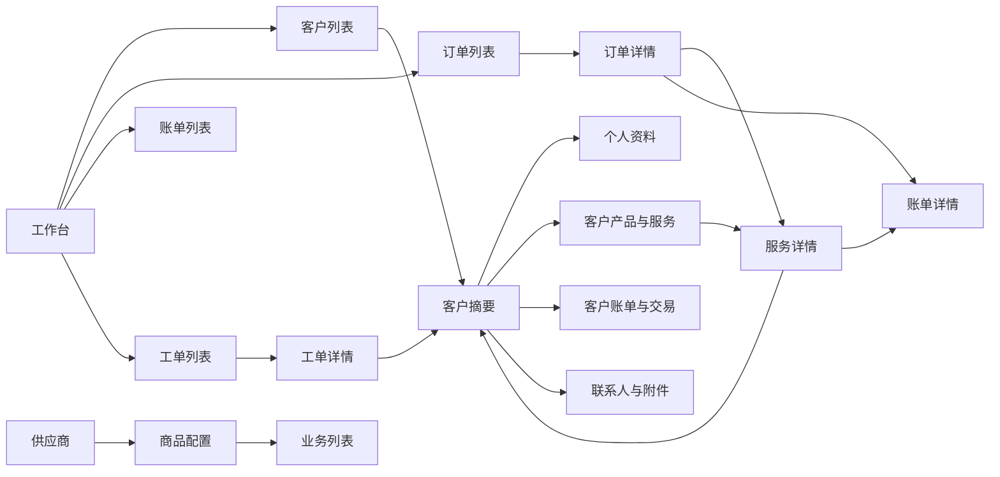

# 魔方后台还原记录

日期：2026-10-07。参考站为用户授权的本机魔方测试站 `http://127.0.0.1/admin123/`；凭据不保存到文档、代码或浏览器状态文件。使用 Playwright CLI 独立 Linux Chrome，读取页面并操作导航，不提交旧后台业务写入。

## 基线优先级

1. 魔方测试站决定导航层级、页面结构、字段分组、操作位置及跨页面关系。
2. 旧副本文档补充未能通过当前账号或数据观察的页面分支。
3. Arco Pro 提供蓝色主色、中性灰阶、紧凑控件的视觉语言；仍使用 Next.js、React、shadcn/ui、Radix、lucide。
4. Go API 决定真实字段、状态、权限和动作。缺少后端能力的旧页登记为待实现，完成后按旧布局接入。

用户已明确不开发评论互动。本次无新增依赖、无数据库结构变更、无旧数据导入。

## 现场观察

桌面视口1440×1000。实测顶部60px、业务侧栏200px，主内容从x=200、y=60开始。顶栏包含客户、业务、财务、工单、功能、设置、资源与商店；工作台不显示侧栏。页面以紧凑表格、分组表单及底部动作构成。

| 旧页面 | 现场结构/交互 | 新页面 |
| --- | --- | --- |
| `#/home-page` | 问候、订单概览、待办、收入概览、交易统计、系统日志、客户与工单概况 | `/admin` |
| `#/customer-list` | 添加/高级搜索、ID/姓名/邮箱/服务/财务/分组/状态/销售/信用额、分页；姓名进入摘要 | `/admin/customers` |
| `#/customer-view/abstract` | 水平客户页签、账户身份与资料、工单/财务/产品概况 | `/admin/customers/{id}` |
| `#/customer-view/person` | 个人资料、账户信息、其他设置；保存/取消位于表单底部 | `/admin/customers/{id}?tab=profile` |
| `#/customer-view/product-innerpage` | 客户上下文、产品、财务、接口命令；资源字段与系统操作 | `/admin/services/{id}` |
| `#/order-list` | 状态页签、添加订单、高级搜索、订单/客户/产品/IP/时间/金额/付款状态/订单状态；批量操作在表格后 | `/admin/orders` |
| `#/bill-management` | 状态筛选、账单/客户/日期/金额/渠道/状态/类型表格、表格后批量及金额汇总 | `/admin/invoices` |
| `#/customer-product` | 全部/已激活/取消/删除/欺诈/待开通/暂停页签；ID、客户、产品主机名、IP、日期、周期、价格、状态 | `/admin/services` |
| `#/support-ticket` | 待处理/已回复/等待/关闭/全部页签；工单标题、提交人、处理人、部门、提交/回复时间 | `/admin/tickets` |
| `#/support-ticket-detail` | 客户/服务关联、消息时间线、回复、部门与处理人 | `/admin/tickets/{id}` |
| `#/general-settings/general` | 基础信息/本地化/显示/安全/维护/调试分区；保存/取消 | `/admin/settings` |
| `#/system-log` | 时间/描述/来源/用户名/IP、搜索清空、分页 | `/admin/audit` |
| `#/product-server` | 产品分组和商品管理入口 | `/admin/products`、`/admin/catalog-groups` |

现场发现旧站存在图标字体/外部资源错误；新站使用现有lucide图标。旧站无效路径 `/product-management` 不作为证据，产品入口以路由清单中的 `/product-server` 为准。旧站观察到的控件不代表对应新后端已经支持。

## 页面关系

客户与工单列表查询条件保留在URL；客户页签使用 `tab`；对应详情返回列表恢复搜索与页码。订单、账单及服务的搜索、状态和分页也已写入URL，详情返回恢复原列表上下文，非法状态或页码恢复默认值。继续采用新系统稳定路径，无需复制旧站hash URL。

## 本批实现

第二批补充范围及真实读取/模拟写入边界见 [第二批验收](admin-mofang-batch2-acceptance.md)。第一批构建与截图记录保留为历史证据。

- 公共外壳：顶部业务域、200px当前业务侧栏、无侧栏工作台、面包屑、移动端全部授权导航；权限按现有能力过滤。
- 工作台：现有dashboard汇总、待办与按权限显示的真实收入统计；不填充旧站尚无接口对应的在线管理员或排行。
- 客户列表：ID、姓名摘要链接、邮箱/账号、分组、状态、销售、余额及原操作；高级搜索可折叠，已有URL筛选自动展开。
- 客户详情：摘要、个人资料、产品/服务、订单、账单、交易记录、联系人、工单、附件；仅提交当前支持的姓名/邮箱/状态字段。
- 服务详情：沿用已部署的产品/财务/接口命令/配置/任务/历史分区；供应商真实结果核验规则保留。
- 商品目录：按真实分类折叠分组，本页商品计数及紧凑表格；商品编辑使用水平分区，基本信息、分类与交付、默认定价与库存、销售设置及底部保存/取消。基本资料切换分区时保留草稿。
- 订单/账单：使用真实状态筛选，批量取消/合并移至表格后；账单显示本页金额汇总，详情与编辑字段更紧凑。财务权限和幂等规则不变。
- 工单：列表显示标题/编号、提交人、部门、处理人及提交/更新时间；详情关联客户/服务，回复、内部备注、处理选项、附件分区保持草稿，返回列表恢复查询。系统日志显示时间、动作、操作者及关联对象，不展开可能含敏感值的原始载荷。
- 设置：基本信息、安全设置、维护设置分区，切换保留草稿，取消恢复已有值，保存沿用完整版本化 PUT。

## 逐页台账

公共外壳影响全部管理路由。下面区分本批结构改造和后续业务页面，不能据此宣称整个后台已像素级还原。

| 范围 | 当前状态 | 下一步 |
| --- | --- | --- |
| 外壳/工作台/客户列表/客户详情 | 本批实现并浏览器验收 | 补齐后端尚未提供的客户摘要聚合字段 |
| 服务列表/服务详情 | 状态导航及详情分区已实现 | 更多动作状态与客户上下文逐项对照 |
| 商品目录/基本编辑 | 分组目录、编辑分区、账期价格矩阵、配置组/阶梯/规则/购买字段及保存/取消已实现 | 继续补真实复杂商品对照 |
| 商品分组/供应商 | 分组编辑、供应商账户/目录、分组导入草稿及固定上游绑定已实现 | 其他系统适配器及更多供应商动作 |
| 订单/取消申请 | 详情、URL 筛选/分页返回和底部批量取消已实现；取消审核增加确认弹窗和反馈 | 更多状态和正式写入验收 |
| 账单/发票/优惠码/报表 | 账单URL筛选/分页返回、底部合并、本页汇总、紧凑详情/编辑已实现 | 发票、优惠码、报表继续对照 |
| 工单详情/列表/系统日志 | 本批重排已实现 | 工单状态筛选和日志搜索需先补后端契约 |
| 工单部门/预设回复/通知 | 公共外壳生效 | 配置表单与通知流程继续对照 |
| 内容/下载/客户文件 | 公共外壳生效 | 类别列表、编辑页与上传交互对照 |
| 设置/权限/迁移 | 设置分区及保存/取消已实现，权限/迁移公共外壳生效 | 权限与迁移表单继续对照 |
| 信用额/实名认证/推介/提现/插件商店 | 后端能力未完成 | 后端契约完成后实施真实页面 |

## 验收口径

检查桌面1440、平板1024、手机390和320；顶栏与侧栏不遮挡内容，全页无横向溢出，表格允许自身滚动。验证业务域/子路由高亮、菜单折叠、手机抽屉、URL搜索返回、客户九页签、只读能力入口、表单取消和错误保留。截图仅保存在Git忽略的 `output/playwright/`；编译通过不代替运行时验收。

2026-10-07 本批编译和运行时验收：Next.js webpack生产构建和TypeScript通过；ESLint为0错误，仅认证页两个既有图片warning。首次构建读取移动目录遗留的绝对缓存路径而失败，清空可再生 `.next` 后重新构建成功；失败构建不计为通过。

已验证10条核心路由在1440/1024/390/320四种宽度无全页横向溢出和JavaScript页面异常；客户9页签、移动菜单打开/Esc关闭、客户搜索进入详情并返回、设置草稿切换/取消通过。订单待支付筛选仅剩1条待支付记录，批量取消在未选择时禁用；账单待支付筛选仅剩1条，汇总由219.33元变为13.33元，合并在无有效选择时禁用。商品基本资料切换定价后草稿保留，取消恢复原名；工单内部备注切换附件后草稿保留，返回列表恢复搜索。以上流程未提交财务、商品、工单或供应商写入；未重复验收真实只读账号的写接口拒绝、并发冲突及每个页面的全部错误状态。

最终构建 `yZezEb3TlhVmBAAsMrHbx` 追加验证订单、账单、账单详情、商品目录、商品编辑、工单列表、工单详情、系统日志8页×4宽度，32项均无全页横向溢出、页面异常、可见错误提示或API失败。桌面工作台、商品编辑和390px服务/工单详情截图检查无文本遮挡；服务页仅有既有只读密码字段不在form内的浏览器verbose提示。三项服务active，API `/readyz` 返回PG18 ready。

本机最终截图：`output/playwright/mf-final-dashboard.png`、`mf-final-product-editor.png`、`mf-final-service-mobile.png`、`mf-final-ticket-mobile.png`。所有旧站与新站浏览器观察使用独立Linux Chrome；不视为用户内置浏览器验收，也不代表全部后台功能已还原。
