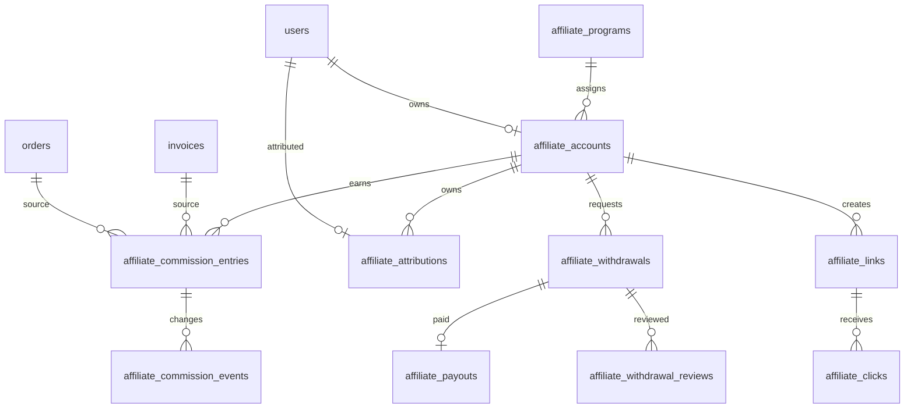

# 推介返利与分销代理系统设计

状态：设计评审稿（2026-10-08）
范围：Go API、Next.js 客户中心与管理后台、PostgreSQL 18、worker 结算任务
本阶段只完成设计和规划，不创建迁移、不注册路由、不修改现有业务代码。

## 1. 目标与边界

系统为客户提供可追踪的推广链接、推荐关系、订单佣金、代理计划和提现申请；为运营人员提供规则配置、佣金审核、提现审核、打款登记和审计。返佣属于资金相关业务，必须与订单、账单、余额流水和支付渠道保持明确的事务边界。

首版覆盖旧系统已经存在的主要能力：推广链接访问统计、注册归因、首次购买返佣、续费返佣、重购返佣、产品级覆盖、营业额阶梯、推荐奖励、待结算/可提现余额、提现申请和后台审核。旧数据只作规则参考；由于此前已确定不把历史数据提取作为重点，首版不承诺完整迁移旧佣金流水。

明确不纳入首版：运行时上传插件、多级无限裂变、自动支付提现、现金券/积分混用、评论或社交互动。未来可在同一模型上增加有限层级代理和新的打款适配器。

## 2. 领域模型

### 2.1 角色

| 角色 | 说明 | 默认能力 |
| --- | --- | --- |
| 普通客户 | 没有推广资格的购买者 | 可被归因，不产生佣金 |
| 推荐人 | 通过审核后获得推广链接的客户 | 单级推荐、查看佣金、申请提现 |
| 代理 | 具有代理计划和合同/审核状态的推荐人 | 可使用代理专属规则、产品覆盖和团队报表；首版仍只结算直接下级 |
| 管理员 | 配置计划、规则、归因和提现 | 按现有 RBAC 控制，所有资金动作写审计 |

推荐人和代理都存为 `affiliate_accounts`，用 `account_type`、`program_id` 和审核状态区分，不另造一套客户表。代理层级字段预留 `parent_account_id`、`level`，但首版约束为 `level=1`，防止未定义多级分配规则时产生资金争议。

### 2.2 计划与规则

`affiliate_programs` 是可启停、可版本化的计划。计划定义默认归因窗口、冻结期、最低提现额、提现手续费、是否允许续费/重购，以及结算币种。规则按事件类型拆分：`first_purchase`、`renewal`、`reorder`、`upgrade`、`referral_bonus`。

规则优先级固定为：

1. 商品+计划的有效产品规则；
2. 代理等级/代理专属规则；
3. 计划默认规则；
4. 未配置则不产生佣金。

每次产生佣金都保存完整规则快照和计算输入，不依赖后续读取当前配置。金额统一为整数分；比例用万分比整数（例如 5% 为 500），固定金额用 `amount_cents`，禁止使用浮点。

## 3. 归因与推广链接

### 3.1 链接

推广人可以生成多个链接，每条链接有不可变的短码、可选产品/落地页、启用状态和备注。链接格式由 Next.js 当前站点生成，例如 `/register?aff=<code>` 或 `/store/<slug>?aff=<code>`；Go API 只校验和记录短码，不信任前端传入的推广人 ID。

访问链接时记录去标识化的点击事件：链接、时间、会话指纹哈希、来源页、落地页和客户端版本。原始 IP 不进入客户可见接口，日志保留期和脱敏规则沿用审计策略。

### 3.2 默认归因规则

- 首次有效点击归因，默认窗口 30 天；同一客户已经绑定推广人后不因后续点击覆盖。
- 注册时只保存临时归因；完成邮箱/短信验证码注册后才转为正式关系。
- 自推、自购、同一支付账户循环注册、被禁用推广人和无效链接不产生佣金。
- 归因关系默认永久绑定到客户，管理员可在审计记录下人工解除或迁移；客户不能自行更换。
- 代理的下级归因仍只绑定一个直接上级。多级代理需要单独启用计划和逐层比例，不能通过修改 `level` 绕过规则。
- 归因和佣金均按当时的计划、产品、客户、订单和账单快照计算。

### 3.3 归因冲突

注册后发现多个临时归因时，按有效点击时间最早者保留；管理员改绑必须填写原因并产生 `affiliate.attribution.changed` 审计事件。已产生的佣金不会因改绑被重算，后续事件使用新关系。

## 4. 佣金计算规则

### 4.1 可计金额

佣金基数默认为账单商品净额（不含税、支付手续费、余额抵扣和优惠赠送部分），规则可声明使用 `net_amount` 或 `gross_amount`。服务费、配置项、升级差额分别在账单项目快照中计算；一次账单包含多个产品时逐项计算后汇总。

计算结果必须满足：金额大于 0、不能超过可计金额、不能超过计划单笔上限。舍入在“分”级别完成，累计舍入差异进入规则快照的 `rounding_cents`，不得由前端处理。

### 4.2 事件

| 事件 | 默认规则 | 备注 |
| --- | --- | --- |
| 首次购买 | 产品规则或计划默认比例/固定金额 | 同一客户同一产品只认定一次，依据已结算订单历史 |
| 续费 | 可单独启用比例/固定金额 | 只对成功支付的续费账单计算 |
| 重购 | 可单独启用比例/固定金额 | 同客户再次购买已结束产品时适用 |
| 升级 | 只对升级差额计佣 | 差额为 0 时不产生佣金 |
| 退款/拒付 | 产生相反方向冲正事件 | 不删除原记录；已提现部分进入待追缴状态 |
| 推荐奖励 | 注册完成或首单支付后一次性发放 | 计划可选择触发点，默认首单支付成功 |

产品规则支持“关闭、继承计划、覆盖计划”三态；比例和固定金额不能同时生效。营业额阶梯按推广人计划周期内已结算净额计算，使用闭区间下限、最高匹配一档，规则版本在账单生成时锁定。

### 4.3 结算时点

支付成功只创建 `pending` 佣金；worker 在冻结期结束且订单/服务没有取消、退款、拒付或待人工核验时，将其转为 `available`。默认冻结期 7 天，计划可配置为 0 天。冻结期间金额不能提现。

佣金进入 `available` 后仍保留可冲正能力。提现申请会锁定可用余额并转为 `reserved`，打款成功才进入 `paid`；失败或驳回释放回 `available`。佣金账本余额与可提现余额均由服务端按事件重放校验，不允许直接编辑余额字段。

## 5. 状态机

### 5.1 佣金条目

```text
pending --(冻结期到期且订单有效)--> available
pending --(退款/取消/拒付)----------> reversed
available --(提现申请锁定)----------> reserved
available --(退款/拒付)-------------> reversed 或 clawback
reserved --(提现驳回/打款失败)------> available
reserved --(打款成功)---------------> paid
```

状态转换必须带事件 ID、操作者/worker、原因、前后金额和规则快照。`clawback` 表示已提现后产生的负佣金，不能让客户余额变为负数；系统产生待追缴项，后续佣金先抵扣，必要时由管理员人工处理。

### 5.2 提现申请

```text
draft -> submitted -> reviewing -> approved -> paying -> paid
                         |            |          |
                         v            v          v
                      rejected      cancelled   failed -> reviewing
```

客户只能创建 `submitted`，不能撤回已 `approved` 或 `paying` 的申请。管理员审核必须填写结果和备注；线下打款首版只登记渠道、流水号、收款账户快照和凭证摘要，不在 Go 内直接调用银行。金额、手续费和实付金额在提交时冻结，后续配置变化不影响旧申请。

### 5.3 代理审核

代理申请使用 `pending/approved/suspended/rejected/closed`。暂停代理不解除已有归因，也不抹除历史佣金；暂停期间可以按计划禁止新佣金或仅禁止提现，具体由计划快照决定。

## 6. 数据库设计

以下为逻辑表，实际迁移时遵循项目现有命名、`created_at/updated_at`、版本号和约束风格。所有金额字段使用 `bigint` 分，所有外部/业务事件带幂等键和唯一约束。

### 6.1 核心表

| 表 | 关键字段 | 约束/用途 |
| --- | --- | --- |
| `affiliate_programs` | `id,name,status,account_type,attribution_days,hold_days,min_withdraw_cents,fee_cents,rule_version` | 计划配置；停用不影响历史快照 |
| `affiliate_accounts` | `id,user_id,program_id,account_type,status,parent_account_id,level,approved_at` | 一个客户最多一个有效账户；代理预留父级字段 |
| `affiliate_links` | `id,account_id,code,landing_path,product_id,status` | `code` 唯一；链接不可改属主 |
| `affiliate_clicks` | `id,link_id,session_hash,referrer,landing_path,created_at` | 统计表，按保留策略清理，不能用于伪造佣金 |
| `affiliate_attributions` | `id,user_id,account_id,link_id,first_clicked_at,registered_at,source_snapshot,status` | 客户归因唯一；改绑写版本和审计 |
| `affiliate_rule_sets` | `id,program_id,version,effective_from,effective_to,default_rules` | 规则版本快照 |
| `affiliate_product_rules` | `id,rule_set_id,product_id,event_type,mode,rate_bps,amount_cents,max_cents` | 产品覆盖规则；`mode` 为 disabled/inherit/override |
| `affiliate_tier_rules` | `id,rule_set_id,lower_cents,upper_cents,rate_bps,amount_cents` | 营业额阶梯，区间不能重叠 |
| `affiliate_commission_entries` | `id,account_id,user_id,order_id,invoice_id,invoice_item_id,event_type,status,amount_cents,available_at,rule_snapshot,source_snapshot,idempotency_key` | 不可变佣金主账；同一来源事件唯一 |
| `affiliate_commission_events` | `id,entry_id,event_type,delta_cents,before_status,after_status,reason,idempotency_key,actor_id` | 追加式状态/金额事件，支持重放和冲正 |
| `affiliate_withdrawals` | `id,account_id,amount_cents,fee_cents,payout_cents,status,payout_method,payout_target_snapshot,idempotency_key` | 提现主单；账户和金额快照 |
| `affiliate_withdrawal_reviews` | `id,withdrawal_id,reviewer_id,decision,note,created_at` | 多次审核记录，不覆盖历史意见 |
| `affiliate_payouts` | `id,withdrawal_id,method,external_ref,status,paid_at,proof_hash,error` | 打款登记/未来渠道适配器边界 |
| `affiliate_settlement_runs` | `id,run_key,window_start,window_end,status,processed_count,error_count` | worker 批次，支持重试和监控 |
| `affiliate_audit_events` | `id,account_id,actor_id,event_type,object_type,object_id,payload_hash,payload` | 归因、规则、审核、打款和人工调整审计 |

佣金表保存客户、商品、订单、账单、账单项目、产品版本和规则的 JSON 快照；外键用于关联查询，快照用于历史解释。提现目标（支付宝/银行卡/企业账户等）只保存加密或脱敏快照，不回填修改后的客户资料。

### 6.2 与现有表的关系



不修改 `users.balance_cents` 作为佣金余额。真正把佣金支付到客户站内余额时，必须由独立的结算动作在同一事务中写 `balance_ledger`（`entry_type='affiliate_payout'`）和佣金事件，并使用独立幂等键；首版提现默认线下打款，不自动转站内余额。

## 7. 事务与并发边界

### 7.1 支付成功

支付 webhook 现有事务锁定支付交易和账单，并完成账单/订单状态变更。佣金创建应在同一事务内追加 `affiliate_commission_entries`，但不能调用外部服务。幂等键使用 `payment_transaction_id + invoice_item_id + event_type + rule_version`，重复回调只能得到同一结果。

### 7.2 退款、取消和拒付

退款事务先锁账单，再锁关联订单和服务，沿用现有财务锁顺序；同一事务只追加冲正事件，不删除原佣金。外部支付退款的未知结果不能冲正，直到查单/人工核验确认。取消未支付订单不产生佣金；支付成功后取消或拒付按已结算金额生成负事件。

### 7.3 提现

提现申请事务锁 `affiliate_accounts` 和符合条件的 `available` 佣金，按确定排序转为 `reserved`，写入申请和事件。余额不足、重复幂等键、并发申请和账户暂停均返回业务冲突，不允许部分锁定后失败。审核/打款各自使用状态版本和操作幂等键，避免重复释放或重复记账。

### 7.4 worker

worker 以 `affiliate_settlement_runs.run_key` 抢占批次，使用短事务分片处理，单条失败进入错误表/重试队列，不阻塞其他佣金。每日任务包括：冻结期结算、过期归因清理、阶梯快照汇总、提现超时提醒、负佣金抵扣和数据一致性巡检。每个任务都需要运行计数、耗时、失败数和最后成功时间。

## 8. API 草案

API 仍由 Go 提供，Next.js 只负责呈现。写接口都要求 `Idempotency-Key`，涉及版本的请求额外要求 `If-Match` 或 `version`。

### 8.1 客户中心

| 方法 | 路径 | 作用 |
| --- | --- | --- |
| `GET` | `/api/v1/affiliate/overview` | 账户状态、待结算/可用/冻结/已提现汇总 |
| `POST` | `/api/v1/affiliate/apply` | 申请成为推荐人/代理 |
| `GET` | `/api/v1/affiliate/links` | 链接列表、点击和注册统计 |
| `POST` | `/api/v1/affiliate/links` | 创建推广链接 |
| `PATCH` | `/api/v1/affiliate/links/{id}` | 启停或修改落地页备注 |
| `GET` | `/api/v1/affiliate/commissions` | 佣金明细，支持事件/状态/时间筛选 |
| `GET` | `/api/v1/affiliate/referrals` | 下级客户摘要，不暴露敏感资料 |
| `POST` | `/api/v1/affiliate/withdrawals` | 创建提现申请 |
| `GET` | `/api/v1/affiliate/withdrawals` | 提现记录和状态时间线 |
| `GET` | `/api/v1/affiliate/withdrawals/{id}` | 提现详情、审核结果和打款摘要 |

### 8.2 管理后台

| 方法 | 路径 | 作用 |
| --- | --- | --- |
| `GET/POST/PATCH` | `/api/v1/admin/affiliate/programs` | 计划列表、创建、启停和发布新版本 |
| `GET/PUT` | `/api/v1/admin/affiliate/programs/{id}/rules` | 默认、产品、阶梯规则编辑和预览 |
| `GET` | `/api/v1/admin/affiliate/accounts` | 推荐人/代理审核、筛选和统计 |
| `POST` | `/api/v1/admin/affiliate/accounts/{id}/approve` | 审核通过/暂停/关闭 |
| `GET` | `/api/v1/admin/affiliate/attributions` | 归因查询与冲突处理 |
| `POST` | `/api/v1/admin/affiliate/attributions/{id}/reassign` | 人工改绑，必须备注 |
| `GET` | `/api/v1/admin/affiliate/commissions` | 佣金、冲正、负佣金和规则快照 |
| `POST` | `/api/v1/admin/affiliate/commissions/{id}/adjust` | 受限人工调整，双重审计和上限校验 |
| `GET` | `/api/v1/admin/affiliate/withdrawals` | 提现审核队列 |
| `POST` | `/api/v1/admin/affiliate/withdrawals/{id}/review` | 通过、驳回、要求补充资料 |
| `POST` | `/api/v1/admin/affiliate/withdrawals/{id}/payout` | 登记打款、流水号和凭证摘要 |
| `GET` | `/api/v1/admin/affiliate/audit` | 归因、规则、佣金和提现审计 |

错误码至少包括：`affiliate_disabled`、`affiliate_not_approved`、`attribution_conflict`、`commission_not_available`、`withdrawal_below_minimum`、`withdrawal_balance_conflict`、`withdrawal_state_conflict`、`payout_duplicate` 和 `manual_adjustment_forbidden`。

## 9. 页面与交互

### 9.1 客户中心

沿用客户中心现有布局，新增“推广返利”入口。首页展示四个金额摘要（待结算、可提现、提现中、累计已提现）和当前计划状态；金额均由 API 返回。链接页提供复制、启停、落地页和点击统计；佣金页用时间线解释“支付成功、冻结、可提现、冲正”；提现页在提交前显示手续费、实付金额、实名要求和不可逆提示。

无资格时显示申请入口；审核中显示状态和补充资料入口；暂停或风控拦截时显示原因和申诉/联系客服入口。移动端列表降级为摘要卡片，详情保留事件时间线，不能只显示颜色状态。

### 9.2 管理后台

在现有客户详情“推广”分区下展示归因、推广人账户、佣金和提现关联；新增“推广返利”业务域，页面顺序为：计划与规则、推广账户、归因与链接、佣金台账、提现审核、结算任务、审计。

规则编辑器必须先显示当前生效版本，再以草稿方式编辑；发布前提供产品、事件、阶梯和示例金额预览。提现审核抽屉显示客户身份、可用余额来源、冻结佣金、收款账户快照和历史审核，审核/打款按钮必须二次确认并要求备注。设计语言遵循 [后台前端设计契约](admin-frontend-design.md)，不引入 Arco 运行时依赖。

### 9.3 权限

建议新增权限：`affiliates.view`、`affiliates.manage`、`affiliates.rules`、`affiliates.commissions`、`affiliates.withdrawals.review`、`affiliates.payout`、`affiliates.audit`。销售人员只能看到授权客户范围；`payout` 与 `withdrawals.review` 默认分离，支持双人复核。客户 API 永远按当前会话用户过滤，不能通过 ID 越权读取其他推广人的下级、收款资料或佣金。

## 10. 旧版映射与迁移策略

旧版逻辑参考 `app/common.php` 注册归因和佣金计算段，以及 `affiliates`、`affiliates_user`、`affiliates_user_temp`、`affiliates_products_setting`、`affiliate_ladder`、提现和用户设置相关表。旧版把余额、待审核余额、提现中余额和累计金额放在推广主表字段中，且部分计算在支付/续费公共函数中完成；Go 端必须拆成事件账本和状态机。

迁移分三档：

1. **默认不迁移历史资金流水**：保留旧库只读，Go 账户从新计划开始，避免无法证明的金额进入可提现余额。
2. **可选摘要迁移**：仅导入客户与推荐关系、推广短码和经过人工核对的可用余额，写入 `migration_source` 和人工复核记录，不导入待结算或提现中金额。
3. **专项历史迁移**：若上线前必须承接旧提现，先导入只读归档表，逐笔核对订单、退款和已打款证据，再由管理员创建等额调整事件；不得直接更新佣金或用户余额。

每次迁移都先只读预检，源数据改变则拒绝导入；保留旧 ID 映射、快照哈希、导入批次和回滚说明。旧版配置字段的“固定金额/百分比、首次/续费/重购开关、产品覆盖、阶梯”映射为规则版本，不把旧的小数金额直接当作分。

## 11. 风险与防护

| 风险 | 防护 |
| --- | --- |
| 自推、刷点击、循环注册 | 归因与付款人/收款人关系校验、速率限制、异常标记，点击不直接产生佣金 |
| 重复回调或重复续费 | 来源事件唯一键、事务锁、规则快照和幂等响应 |
| 退款后已提现 | `clawback` 负事件，后续佣金抵扣，人工追缴队列 |
| 规则修改影响历史 | 规则版本+账单/产品快照，已创建条目不可变 |
| 并发提现超额 | 账户锁、佣金行锁、确定排序、状态版本和幂等键 |
| 管理员误打款 | 审核与打款权限分离、二次确认、收款快照、审计和凭证摘要 |
| 敏感收款信息泄露 | 加密存储、脱敏返回、独立查看/导出权限，禁止进入 URL 和日志 |
| worker 中断或重复执行 | 结算批次、租约/锁、单条幂等和失败重试，未知状态转人工核验 |

## 12. 分批开发与验收

### 批次一：领域基础与只读能力

完成计划、账户、链接、点击、归因、规则版本和佣金事件模型；接入客户注册/订单创建的归因记录；实现客户和后台只读列表、审计和报表。验收重点是重复点击、重复注册、归因冲突、越权读取和规则快照。

### 批次二：支付结算与冲正

在支付成功事务中创建冻结佣金；worker 处理冻结期和可用状态；退款、取消、拒付生成冲正；补充隔离 PG18、重复 webhook、并发结算和 worker 恢复测试。未完成真实支付链路前，结果只能标记为测试环境通过。

### 批次三：客户提现

实现客户中心推广页、提现资料、最低金额/手续费计算、余额锁定和撤回/失败释放。验收整条链路：佣金可用、申请、重复提交、并发申请、驳回、失败和重新申请。

### 批次四：后台审核与打款登记

实现 RBAC、双人复核、审核时间线、线下打款登记和审计。验收收款账户快照、审核权限边界、重复打款、流水号冲突和凭证摘要。

### 批次五：产品覆盖、阶梯与代理

增加产品级规则、营业额阶梯、代理申请/暂停、团队报表和有限一级下级关系；用固定样例验证首次购买、续费、重购、升级、退款和跨规则版本的金额。

### 批次六：迁移和发布评审

按需要执行只读预检、摘要迁移或专项历史迁移；完成负载、并发、重复回调、退款冲正、提现审核、备份恢复和回滚演练。只有 API、页面、权限、数据库、worker 和真实外部支付证据都齐全，才进入替换旧 PHP 的发布评审。

## 13. 待评审决策与本稿默认值

| 决策项 | 本稿默认值 | 影响 |
| --- | --- | --- |
| 归因是否永久 | 是；管理员可审计改绑 | 降低归因争议，改绑需人工 |
| 层级 | 首版单级，字段预留多级 | 不产生未定义的多级资金分配 |
| 冻结期 | 7 天，可按计划设 0 | 降低退款/拒付造成的追缴 |
| 退款 | 追加按实际佣金的冲正事件 | 已提现时进入追缴而不是扣负余额 |
| 最低提现 | 计划配置，建议默认 100 元 | 减少小额人工成本 |
| 手续费 | 固定分，提现提交时锁定 | 配置变更不影响历史申请 |
| 打款 | 首版人工审核+线下登记 | 不引入银行/钱包外部风险 |
| 代理审核 | 需要管理员审核和可选合同状态 | 代理规则可控，历史关系不丢失 |
| 历史数据 | 默认不迁资金流水 | 旧数据仅作参考，避免无法核账 |

以上默认值通过评审后再拆分迁移和实现任务；在评审完成前不开始写 Go 代码或数据库迁移。
